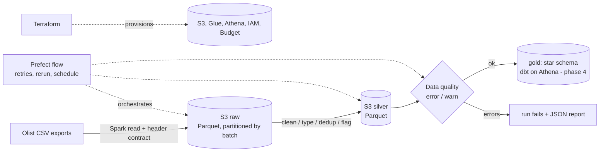

# Architecture

## Layers

| layer | contents | rule |
|---|---|---|
| raw | source text as Parquet + `ingest_batch_id`, `ingest_ts`, `source_file` | all strings, no cleaning; replayable |
| silver | typed, de-duplicated, normalised, `dq_*` flags | never silently drop business rows |
| gold | star schema and marts (phase 4) | built from silver only |

## Decisions

1. **All-string raw.** A malformed value can never fail ingestion and the original text is always recoverable.
2. **Header contract at ingest.** Dropped/renamed columns fail loudly (schema drift) instead of becoming nulls.
3. **Partition by batch + dynamic overwrite.** Rerunning a batch is idempotent and touches nothing else.
4. **Flag, don't drop.** Suspicious business rows get `dq_*` flags; only unusable rows (bad geocodes) go to `geolocation_rejects`.
5. **`geolocation_zip` table.** One row per zip prefix, the only safe join target for customers/sellers (raw has up to 1,146 points per prefix).
6. **Two severities.** Key and referential breaks fail the run; known upstream quirks warn and are always reported.
7. **Same code on laptop, MinIO and S3.** Only environment variables change.

## Roadmap

| phase | scope | status |
|---|---|---|
| 1 | repo, Terraform (S3, Glue, Athena, IAM, budget), Docker Compose, CI | done (needs first real run) |
| 2 | Spark raw -> silver, data quality, Prefect flow, tests | done (needs first real run) |
| 3 | register silver in Glue Catalog, query from Athena | next |
| 4 | gold star schema with dbt-athena + tests | |
| 5 | Airbyte ingestion (Postgres -> S3) | |
| 6 | failure injection, monitoring/alerts, runbook + RCAs | |
| 7 | dashboard (Tableau Public) | |
